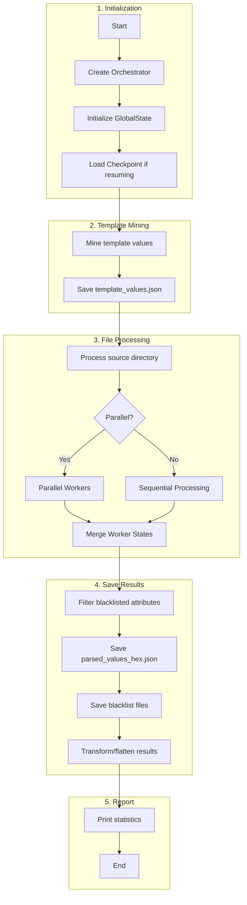
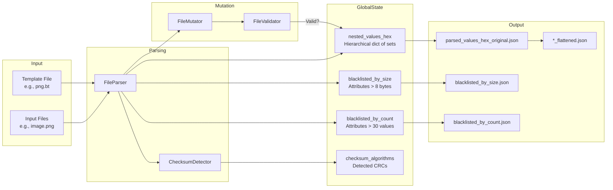
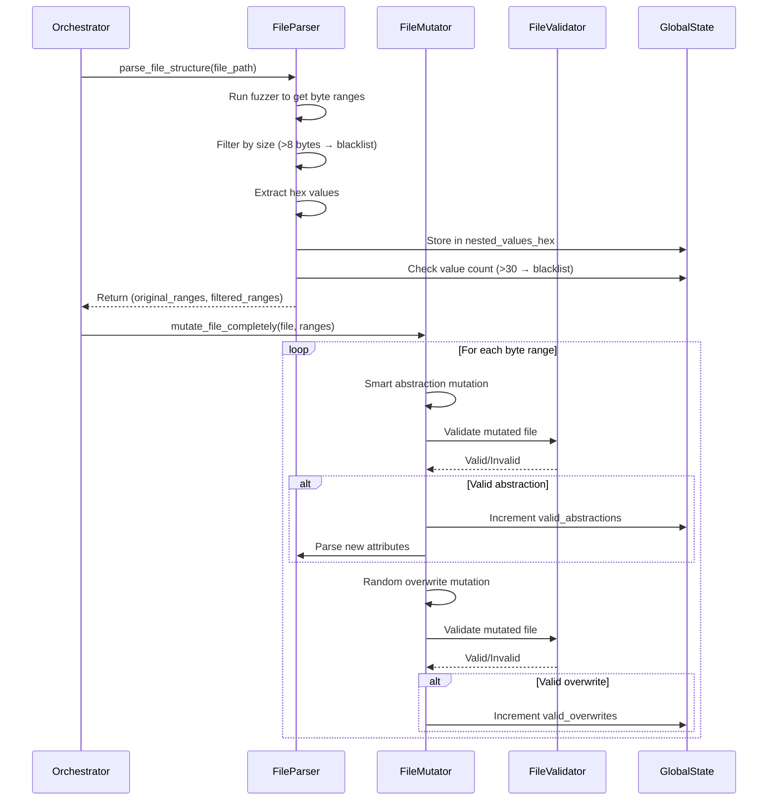
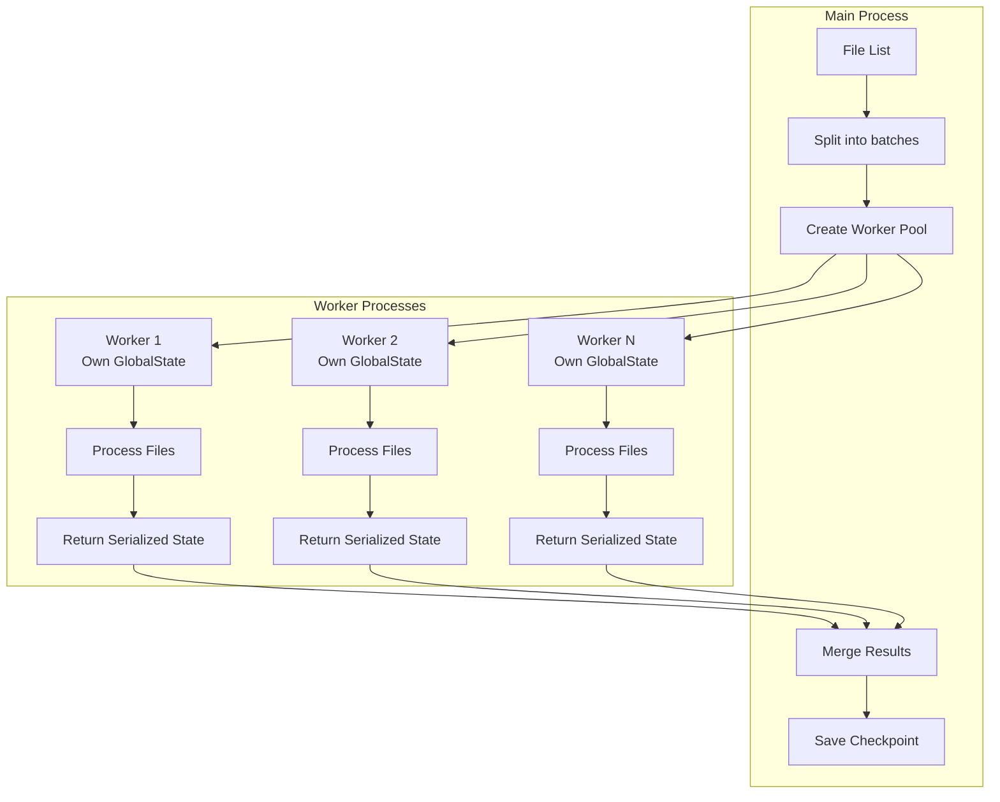
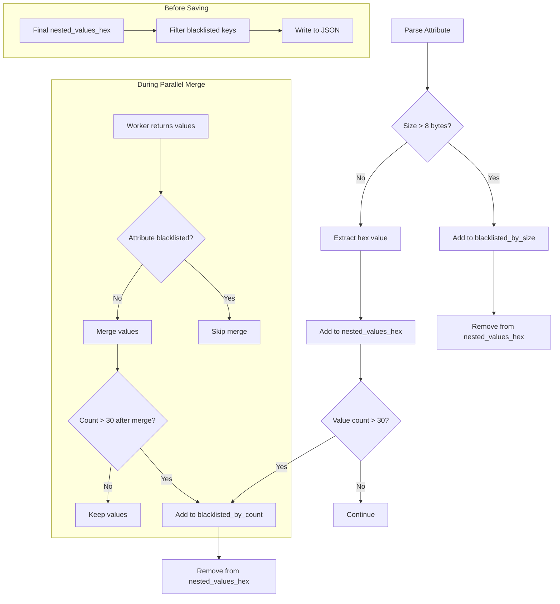

# Learning Constraints Module

A modular system for file format fuzzing and constraint discovery through systematic analysis. This module provides tools for parsing file structures, performing mutations, and discovering format constraints.

## Quick Start

```python
from learning_constraints import LearningConstraintsOrchestrator, Config

def main():
    Config.FUZZER_DIR = "build"            # where <type>-fuzzer binaries live (default: ".")
    orchestrator = LearningConstraintsOrchestrator(file_type="png", source_dir="testcases/png")
    results = orchestrator.run_complete_process()
    return 0 if results["ok"] else 2

if __name__ == "__main__":                  # required: worker processes re-import this module
    raise SystemExit(main())
```

The `__main__` guard is not optional. Worker processes are started with the "spawn" method on
macOS and Windows and re-import the calling script; without the guard every worker dies with
"A process in the process pool was terminated abruptly".

## Command Line Usage

```bash
# Run from the repository root. Binaries built by build.sh live in build/.
python scripts/run_learning_constraints.py png 10 testcases/png --fuzzer-dir build

# Sequential run, strict validator (identify -regard-warnings / ffmpeg -xerror)
python scripts/run_learning_constraints.py mp4 --workers 1 --strict --fuzzer-dir build

# Resume the latest incomplete run / force a new run without the prompt
python scripts/run_learning_constraints.py png --resume
python scripts/run_learning_constraints.py png --new
```

Positional arguments: `<file_type> [max_files] [source_dir]`. `max_files` applies to the source
directory only (files are taken in sorted name order); the special-file pass is capped separately by
`MAX_SPECIAL_FILES`. Exit codes: 0 success, 1 error, 2 no file succeeded, 130 interrupted. When
stdin is not a terminal the script never prompts.

Run the test-suite with `python3 -m unittest discover -s learning_constraints/tests`.

## Module Architecture

```
learning_constraints/
├── main.py              # Orchestrator - coordinates entire process
├── config.py            # Configuration and GlobalState
├── parsers.py           # File parsing and value extraction
├── mutators.py          # File mutation (abstraction & overwrite)
├── validators.py        # File format validation
├── parallel.py          # Multi-process parallel execution
├── checkpoint.py        # Progress saving/resuming
├── transformers.py      # Result JSON transformation
├── result_saver.py      # Result file saving
├── statistics.py        # Statistics reporting
├── checksum_detector.py # CRC/checksum detection
└── utils.py             # Shared utility functions
```

## Processing Flow

### Complete Process Flow

```
START
  │
  ▼
┌─────────────────────────────────────────────────────────────────┐
│ 1. INITIALIZATION                                               │
│    Orchestrator → GlobalState → CheckpointManager               │
│    (Load checkpoint if resuming)                                │
└─────────────────────────────────────────────────────────────────┘
  │
  ▼
┌─────────────────────────────────────────────────────────────────┐
│ 2. TEMPLATE MINING                                              │
│    FileParser.mine_interesting_values_from_template()           │
│    Template (png.bt) → ffcompile → Extract predefined values    │
│    → Save template_values.json                                  │
└─────────────────────────────────────────────────────────────────┘
  │
  ▼
┌─────────────────────────────────────────────────────────────────┐
│ 3. FILE PROCESSING (for each file in directory)                 │
│                                                                 │
│    ┌─────────────┐     ┌─────────────┐     ┌─────────────┐     │
│    │  Worker 1   │     │  Worker 2   │     │  Worker N   │     │
│    │ (parallel)  │     │ (parallel)  │ ... │ (parallel)  │     │
│    └──────┬──────┘     └──────┬──────┘     └──────┬──────┘     │
│           │                   │                   │             │
│           └───────────────────┴───────────────────┘             │
│                               │                                 │
│                               ▼                                 │
│                      Merge Worker States                        │
│                      Enforce Blacklist Limits                   │
└─────────────────────────────────────────────────────────────────┘
  │
  ▼
┌─────────────────────────────────────────────────────────────────┐
│ 4. SAVE RESULTS                                                 │
│    Filter blacklisted → Save JSON files → Transform/flatten     │
└─────────────────────────────────────────────────────────────────┘
  │
  ▼
END (Print statistics)
```

### Single File Processing

```
INPUT FILE (e.g., image.png)
  │
  ▼
┌─────────────────────────────────────────────────────────────────┐
│ PARSE: FileParser.parse_file_structure()                        │
│                                                                 │
│   Run fuzzer → Get byte ranges with attributes                  │
│        │                                                        │
│        ▼                                                        │
│   For each attribute:                                           │
│        │                                                        │
│        ├── Size > 8 bytes? ──YES──► Add to blacklisted_by_size  │
│        │                           (skip this attribute)        │
│        │                                                        │
│        └── NO ─► Extract hex value                              │
│                       │                                         │
│                       ▼                                         │
│                  Store in nested_values_hex                     │
│                       │                                         │
│                       ▼                                         │
│                  Count > 30? ──YES──► Add to blacklisted_by_count│
│                       │              (remove values)            │
│                       │                                         │
│                       └── NO ─► Keep values                     │
│                                                                 │
│   Also: Detect checksums/CRCs (ChecksumDetector)                │
└─────────────────────────────────────────────────────────────────┘
  │
  ▼
┌─────────────────────────────────────────────────────────────────┐
│ MUTATE: FileMutator.mutate_file_completely()                    │
│                                                                 │
│   For each byte range (not blacklisted):                        │
│        │                                                        │
│        ├── Smart Abstraction Mutation                           │
│        │        │                                               │
│        │        ▼                                               │
│        │   Modify bytes → Validate (FileValidator)              │
│        │        │                                               │
│        │        ├── VALID ──► Save special file                 │
│        │        │             Parse for new attributes          │
│        │        │             Increment valid_abstractions      │
│        │        │                                               │
│        │        └── INVALID ─► Discard                          │
│        │                                                        │
│        └── Random Overwrite Mutation                            │
│                 │                                               │
│                 ▼                                               │
│            Overwrite with random bytes → Validate               │
│                 │                                               │
│                 ├── VALID ──► Increment valid_overwrites        │
│                 │                                               │
│                 └── INVALID ─► Discard                          │
└─────────────────────────────────────────────────────────────────┘
  │
  ▼
NEXT FILE (or END if no more files)
```

### Blacklisting Flow

```
Attribute parsed
      │
      ▼
 Size > 8 bytes? ───YES───► blacklisted_by_size
      │                            │
      NO                           ▼
      │                     Remove from values
      ▼                     Skip in mutations
 Add value to set
      │
      ▼
 Count > 30? ───────YES───► blacklisted_by_count
      │                            │
      NO                           ▼
      │                     Remove all values
      ▼                     Skip in mutations
 Keep value
      │
      ▼
 [During parallel merge]
      │
 Already blacklisted? ─YES─► Skip merge (don't add new values)
      │
      NO
      │
      ▼
 Merge worker values
      │
      ▼
 Count > 30 now? ───YES───► blacklisted_by_count
      │
      NO
      │
      ▼
 Keep merged values
```

## Key Data Structures

### GlobalState

Holds all collected data during processing:

All bookkeeping is keyed by *cleaned path*: the fuzzer's attribute label with every `_<N>` array
index removed, e.g. `file~chunk_3~plte~plteChunkData~btRed_2` → `file~chunk~plte~plteChunkData~btRed`.
The same field in different array elements pools together; the same field name under different
parents (`id` in every AVI struct, `size` in every MP4 box) stays apart until the leaf-keyed
flattened output is written.

| Field                      | Type          | Description                                                     |
| -------------------------- | ------------- | --------------------------------------------------------------- |
| `nested_values_hex`        | `defaultdict` | Cleaned path segments → set of hex values                       |
| `blacklisted_by_size`      | `set`         | Cleaned paths of fields larger than MAX_ATTRIBUTE_SIZE_BYTES    |
| `blacklisted_by_count`     | `set`         | Cleaned paths with more than MAX_UNIQUE_VALUES_PER_ATTRIBUTE    |
| `legacy_blacklisted_names` | `set`         | Leaf names loaded from a version-1 checkpoint (matched by name) |
| `seen_attribute_paths`     | `set`         | Every cleaned path met in any file or valid mutant (drives "special" detection) |
| `dropped_arrays`           | `dict`        | Leaf arrays skipped for having > MAX_ARRAY_ELEMENTS_LEARNED elements |
| `checksum_algorithms`      | `dict`        | Detected CRC types per chunk, compression methods               |
| `valid_abstractions_count` | `int`         | Successful abstraction mutations                                |
| `valid_overwrites_count`   | `int`         | Successful overwrite mutations                                  |

### ByteRange (dataclass)

Represents a parsed *leaf* field with byte positions. Struct-level lines of the fuzzer output
(`8,32,file~chunk`) are recognised as containers and never become byte ranges.

```python
@dataclass
class ByteRange:
    start: int        # Start byte offset (inclusive)
    end: int          # End byte offset (inclusive)
    attribute: str    # Raw attribute label (e.g., "file~chunk_1~crc")
    flags: tuple      # Extra fuzzer flags: "Optional", "Appendable"

    size: int                 # end - start + 1
    cleaned_key: str          # "crc"
    cleaned_path: str         # "file~chunk~crc"
    optional: bool
    def is_within_size_limit(self, max_bytes=8) -> bool
```

### Parse filtering rules (`FileParser.parse_lines`)

1. Lines whose range is inverted or outside the file are dropped (the ZIP template emits such lines
   for empty extra-field data).
2. Only leaf lines are kept; a label that is a prefix of another label is a struct.
3. Identical ranges (template re-reads such as `size_1`) collapse to the first emitted.
4. A leaf array (`name`, `name_1`, `name_2`, ...) with more than `MAX_ARRAY_ELEMENTS_LEARNED`
   elements is dropped entirely, element 0 included (JPEG scan data, BMP palettes); smaller arrays
   are kept and pooled under the base name (PNG PLTE entries, MP4 brand lists).
5. Leaves larger than `MAX_ATTRIBUTE_SIZE_BYTES` bytes are blacklisted by path, for every instance.

## Module Responsibilities

| Module                   | Responsibility                                          |
| ------------------------ | ------------------------------------------------------- |
| **main.py**              | High-level orchestration, coordinates workflow          |
| **config.py**            | Configuration constants, GlobalState class              |
| **parsers.py**           | Parse files with fuzzer, extract byte ranges and values |
| **mutators.py**          | Mutation strategies (abstraction, overwrite)            |
| **validators.py**        | Validate files using external tools (ImageMagick, etc.) |
| **parallel.py**          | Multi-process execution, state merging                  |
| **checkpoint.py**        | Save/restore progress for resumability                  |
| **transformers.py**      | Flatten nested JSON results                             |
| **result_saver.py**      | Write all result files to disk                          |
| **statistics.py**        | Print processing statistics                             |
| **checksum_detector.py** | Detect CRC algorithms in file chunks                    |
| **utils.py**             | Shared helpers (key cleaning, byte operations)          |

## Configuration

Key settings in `config.py`:

| Setting                           | Default | Description                                                        |
| --------------------------------- | ------- | ------------------------------------------------------------------ |
| `FUZZER_DIR`                      | `.`     | Directory holding `<type>-fuzzer` (use `build`)                    |
| `MAX_ATTRIBUTE_SIZE_BYTES`        | 8       | Fields larger than this many bytes (inclusive) are blacklisted     |
| `MAX_UNIQUE_VALUES_PER_ATTRIBUTE` | 30      | Blacklist a field once it has more unique values                   |
| `MAX_ARRAY_ELEMENTS_LEARNED`      | 16      | Leaf arrays with more elements are neither learned nor mutated     |
| `MAX_SPECIAL_FILES_PER_FILE`      | 5       | Special files saved per input file                                 |
| `MAX_SPECIAL_FILES`               | 50      | Special files processed in the second pass                         |
| `VALIDATOR_STRICT`                | False   | Make decoder warnings fail a mutant (`--strict`)                   |
| `IDENTIFY_RESOURCE_LIMITS`        | 512MiB memory/map, 2GiB disk, 10 s | `-limit` flags passed to `identify`     |
| `FUZZER_TIMEOUT` / `VALIDATOR_TIMEOUT` | 60 s | Per-call timeouts for the fuzzer and the validators              |
| `PARALLEL_WORKERS`                | 10      | Number of parallel workers (1 = sequential)                        |
| `PARALLEL_FILE_TIMEOUT`           | 900 s   | Per-file budget used to bound each parallel batch                  |
| `CHECKPOINT_SAVE_INTERVAL`        | 10      | Save checkpoint every N files ...                                  |
| `CHECKPOINT_SAVE_SECONDS`         | 30      | ... or whenever this many seconds passed since the last save       |
| `FLATTEN_MAX_VALUES`              | 20      | Flattened leaves with more values become `"More than 20 values"`   |
| `ENABLE_CHECKSUM_DETECTION`       | True    | Detect CRC algorithms (PNG, ZIP) and compression methods (BMP, PNG, ZIP) |

Checkpoints are also written after every parallel batch, on completion, and when the process
receives SIGINT or SIGTERM. A finished run is marked `completed` and is never offered for resume.

## Output files (`logs/<timestamp>_<type>/results/`)

| File                                              | Content                                                    |
| ------------------------------------------------- | ---------------------------------------------------------- |
| `<type>_parsed_values_hex_original.json`          | Nested learned values (blacklisted leaves removed) + checksum info |
| `<type>_parsed_values_hex_original_flattened.json` | Leaf-name keyed flattening (values pooled across parents)  |
| `<type>_parsed_values_hex_original_flattened_paths.json` | Cleaned-path keyed flattening                        |
| `<type>_blacklisted_by_size.json` / `_by_count.json` | Blacklisted cleaned paths and the thresholds            |
| `<type>_dropped_arrays.json`                      | Leaf arrays skipped for size, with element counts          |
| `<type>_template_values.json` (+ `_flattened`)    | Values mined from the template by ffcompile                |
| `<type>_run_summary.json`                         | Per-pass counts, failures, timing, `ok` flag               |

`processed_success.log` / `processed_failed.log` in the run directory list every file with its
outcome, in both sequential and parallel mode.

## Supported File Types

- **Images**: GIF, JPG, PNG, BMP
- **Audio**: MP3, WAV
- **Video**: MP4, AVI
- **Archives**: ZIP
- **Network**: PCAP
- **Music**: MIDI

## Requirements

- **ImageMagick**: For image validation
- **FFmpeg**: For audio/video validation
- **Wireshark**: For PCAP validation
- **TiMidity**: For MIDI validation
- **Format-specific fuzzers**: `{file_type}-fuzzer` executables (built into `build/` by `build.sh`)

The validator is the oracle that defines "valid", so it defines what is learned. The default lenient
mode accepts files that decode with warnings; `--strict` (`VALIDATOR_STRICT`) rejects them. Record
the choice alongside any results.

## Detailed Flow Diagrams (Mermaid)

For interactive visualization, these Mermaid diagrams provide detailed views of each process.

### Execution Flow Overview



### Data Flow Diagram



### Single File Processing Flow



### Parallel Processing Flow



### Blacklisting Logic



## Documentation

For comprehensive documentation, usage examples, and detailed explanations, see:
**[README_COMPREHENSIVE.md](README_COMPREHENSIVE.md)**

Note: that document predates the `checkpoint.py`/`parallel.py`/`checksum_detector.py`/
`result_saver.py`/`statistics.py` split described above and may be out of date in places;
this README is the current source of truth for module structure.
